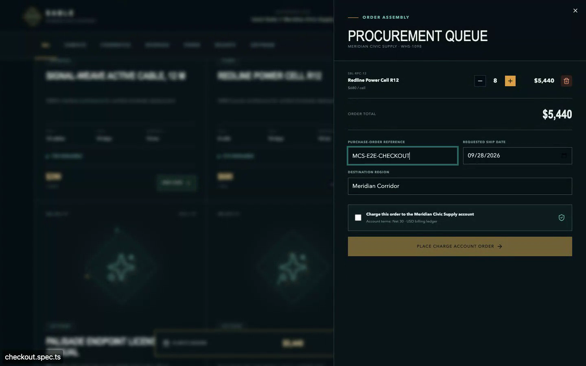

# SABLE Systems Distribution Portal

A local web application for the fictional SABLE Systems wholesale business.
The portal provides inventory-aware ordering, charge-account checkout, order
history, and COV-E customer support. COV-E runs on DeepSeek V4.1 Flash through
OpenRouter. No local model weights or inference server are required.

Built with React, Vinext, and Tailwind CSS, with a Cloudflare Workers backend
and a D1/SQLite database.

## Demos

Select a thumbnail to open the video.

| Order to support · 36 seconds                                                                                                    | Playwright checkout test · 21 seconds                                                                                                                         |
| -------------------------------------------------------------------------------------------------------------------------------- | ------------------------------------------------------------------------------------------------------------------------------------------------------------- |
| [](docs/media/app-demo.mp4)                                                        | [](docs/media/checkout-test.mp4)                                                                |
| Place an order, then ask COV-E for its details and shipment status. This recording shows the historical local inference version. | Watch the existing checkout test run and its passing report. Checks cover cart removal, account charges, inventory reservations, and persisted order history. |

## Setup

Requires Node.js 22.13+ and an [OpenRouter API key](https://openrouter.ai/settings/keys)
with credits.

```sh
npm ci
cp .env.example .env # Only if you do not already have a .env file.
```

In `.env`, add your key. The example includes these defaults for the DeepEval judge:

```dotenv
OPENROUTER_API_KEY=your-key
OPENROUTER_JUDGE_REASONING=true
OPENROUTER_JUDGE_REASONING_EFFORT=high
OPENROUTER_JUDGE_MAX_TOKENS=8192
```

COV-E uses DeepSeek V4.1 Flash; DeepEval uses regular Luna for all judging.
Remove any old `OPENROUTER_JUDGE_MODEL` setting; it is no longer used.

Start the app:

```sh
npm run dev
```

Open [http://127.0.0.1:8016](http://127.0.0.1:8016). Press Ctrl+C to stop.
Unexpected server errors are logged in that terminal with the failed operation
and error message; request bodies, cookies, and keys are not logged.
Run `npm ci` again when `package-lock.json` changes.

## Configuration

Launchers load `.env`; existing shell variables take precedence. Keep the API key
server-side and out of Git. Hosted inference sends customer questions, authorized
records, and saved conversation history to OpenRouter and the selected provider.

See [OpenRouter configuration](docs/inference.md#configuration) for provider restrictions,
reasoning settings, token budgets, and [Cloud setup](docs/inference.md#cloud-runtime).

## Usage

Sign in at `/login` with a demo account:

| Distributor                       | Email                              | Access phrase     |
| --------------------------------- | ---------------------------------- | ----------------- |
| Calder Pike Distribution          | `mara.venn@calderpike.example`     | `Sable-WHS-0427!` |
| Meridian Civic Supply             | `imani.kade@meridiancivic.example` | `Sable-WHS-1098!` |
| Northline Prosthetics Cooperative | `rowan.sato@northline.example`     | `Sable-WHS-2714!` |
| Halcyon Industrial Exchange       | `lena.orr@halcyonexchange.example` | `Sable-WHS-5830!` |

- **Shop** (`/shop`): browse inventory, order case packs, and charge your account.
- **Orders** (`/orders`): search order history and filter by status.
- **Support** (`/support`): ask COV-E about your records and manage conversations.
  COV-E is read-only and cannot place, change, or cancel orders.

If checkout loses its response, use **Retry this order** to recover the original
receipt. After closing or reloading the page, check order history before ordering again.

## Local data

The database initializes automatically with fictional distributors, inventory,
orders, shipments, returns, and support records. Existing data is preserved.

- `.wrangler/`: local database and runtime state.
- `reports/`: model runs and evaluation evidence.
- [Schema](db/schema.ts) and [seed data](db/seed.ts): database definitions.

Runtime state and reports are Git-ignored. Supported database upgrades run on
startup, including seed data corrections: they rewrite only the seeded records
and keep orders, sessions, and conversations you created. If an upgrade is
rejected, preserve the database and inspect the error before attempting a
repair or reset.

## Security boundaries

This is a local demo with synthetic data and published credentials. The launchers
bind to loopback and enable demo authentication; production builds disable it.
Do not expose the local runtime through a proxy or tunnel. Public hosting requires
private accounts and a deployment-specific access policy.

Records are scoped to the signed-in distributor; support conversations belong to
individual users. See [Authentication and permissions](docs/authentication.md)
and [Support API](docs/support-api.md) for access rules, quotas, and request limits.
Use `npm run audit:deps` to check npm dependency advisories.

## Testing

Install [uv](https://docs.astral.sh/uv/getting-started/installation/) and prepare the
Python 3.12 judge environment before running the full checks:

```sh
npm run setup:judge
npm run check
```

For browser tests, install Chromium once:

```sh
npx playwright install chromium
npm run test:e2e
```

| Command               | Purpose                                                                   |
| --------------------- | ------------------------------------------------------------------------- |
| `npm run check`       | Lint, formatting, types, app and Python tests, seed validation, and build |
| `npm test`            | App unit and integration tests                                            |
| `npm run test:python` | Python evaluator tests                                                    |
| `npm run test:e2e`    | Build and browser tests                                                   |
| `npm run test:model`  | Live chatbot tests, repeated samples, and advisory judging; billed        |
| `npm run test:judge`  | Judge calibration; billed                                                 |

Offline and browser tests use controlled responses and do not incur model charges.
CI runs both on Linux. Browser and live-model suites run separately from
`npm run check`. Python npm commands require a POSIX shell.

### Judge evaluations

DeepEval uses regular Luna to assess factual support, completeness,
and support policy. Judgments are advisory; deterministic application checks
remain required. See [judge metrics](docs/inference.md#judge-metrics) and
[evaluation assertions](docs/evaluation-assertions.md) for scope and limitations.

```sh
npm run test:judge -- --list                       # List cases; no API calls.
npm run test:judge                                # Run all cases; billed.
npm run test:judge -- --category account-authorization
npm run test:judge -- --transcript reports/model-runs/example.log
```

The collection has 132 cases and 148 checks, including deliberately incorrect
answers. A check passes when the judge matches its expected result. Cases and
metrics run serially; `--concurrency` accepts only `1`.

Collection reports appear under `reports/judge-runs/`: HTML for reading, JUnit XML
for test viewers, and JSON/JSONL for detailed evidence. Transcript mode uses
JSON/JSONL and evaluates saved answers without generating new ones. Reports show
passed, failed, error, and pending counts and retain partial results if interrupted.
Grading disagreements fail; execution errors remain errors. Rate limits (429),
transient provider errors (500/502/503/504, including errors inside HTTP 200
responses), and incomplete HTTP 200 bodies share a limit of three retries per
request. Retries use backoff and honor `Retry-After` up to 60 seconds; longer waits
remain errors. Grading failures are not retried.
DeepEval telemetry and cloud reporting are disabled; reports stay local.
